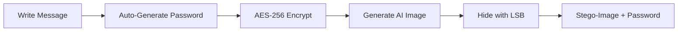
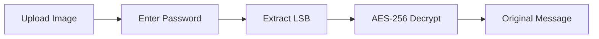
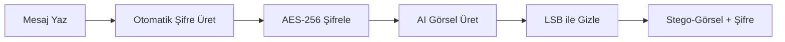
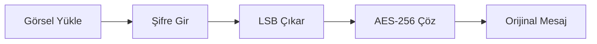

#  CryptCanvas v1.0

# CryptCanvas v1.0

> **AI-Powered Secret Messaging App** — Hide secret messages beneath art.

[](https://python.org)
[](https://streamlit.io)
[](LICENSE)
[]()

---

## 📖 About the Project

**CryptCanvas** is a secret messaging application that combines **steganography**, **artificial intelligence**, and **modern cryptography**. It hides your messages deep within the pixels of unique, AI-generated artworks, protected with military-grade encryption.

> *"A secret in every brushstroke..."*

---

## ✨ Features

| Feature | Description |
|---------|-------------|
| 🔐 **AES-256-CBC Encryption** | A unique 12-character password for every message, with a random IV for semantic security |
| 🎨 **AI Image Generation** | Derives a prompt from the message content and produces unique images via the Picsum Photos API |
| 🖼️ **LSB Steganography** | Embeds the message in the least significant bits of the RGB channels (lossless PNG) |
| 🖥️ **Dual Interface** | Terminal (CLI) and modern Web (Streamlit) |
| 📦 **Independent Modules** | Encryption, Steganography, and AI Image — each can be used on its own |
| 🇹🇷 **Turkish Interface** | Fully Turkish user experience |

---

## 🏗️ Architecture

```
CryptCanvas/
├── app.py                 # CLI (Terminal) interface
├── web_app.py             # Streamlit Web interface
├── images/                # Input images (AI-generated)
├── output/                # Output images with hidden messages
└── modules/
    ├── __init__.py
    ├── encryption.py      # AES-256 encryption/decryption
    ├── steganography.py   # LSB steganography (hide/extract)
    └── ai_image.py        # AI image generation (Picsum Photos)
```

---

## 🔄 How It Works

### 📤 **Sender (Hiding a Message)**


1. The user writes the secret message
2. The system generates a **unique 12-character password**
3. The message is encrypted with **AES-256-CBC** → Base64
4. The AI generates an **artistic image** from the message's keywords
5. The encrypted data is hidden in the RGB channels of the pixels using the **LSB method**
6. Output: `output/gizli_mesaj_<timestamp>.png` + **password** (must be shared through a separate channel)

### 📥 **Receiver (Decrypting a Message)**


1. The stego-image is uploaded
2. The password received from the sender is entered
3. The Base64 data is **extracted from the pixels via LSB**
4. It is decrypted with **AES-256**
5. The original message is revealed

---

## 🚀 Installation

### Requirements
- Python 3.8+
- pip

### Dependencies
```bash
pip install pycryptodome pillow requests streamlit
```

### Quick Start
```bash
# 1. Clone the project
git clone <repo-url>
cd CryptCanvas

# 2. Install dependencies
pip install -r requirements.txt

# 3a. Terminal version
python app.py

# 3b. Web version
streamlit run web_app.py
```

> **Note:** If there is no `requirements.txt` file, use the `pip install` command above.

---

## 💻 Usage

### 1. Terminal Interface (CLI)
```bash
python app.py
```
```
╔══════════════════════════════════════════════╗
║          🎨 CryptCanvas v1.0                 ║
║     AI Gizli Mesajlaşma Uygulaması           ║
╚══════════════════════════════════════════════╝

📋 MENÜ:
  1. 📤 Gizli Mesaj Gönder (Gönderen)
  2. 📥 Gizli Mesaj Çöz (Alıcı)
  3. 🚪 Çıkış
```
*(The interface text is in Turkish: "AI Secret Messaging App" / Menu: 1. Send Secret Message (Sender), 2. Decrypt Secret Message (Receiver), 3. Exit.)*

### 2. Web Interface (Streamlit)
```bash
streamlit run web_app.py
```
Opens at `http://localhost:8501` in your browser.

**Tabs:**
- 📤 **Send Secret Message** — Write a message, choose a size, download
- 📥 **Decrypt Secret Message** — Upload the image, enter the password, read

---

## 🔐 Security Details

| Component | Standard | Description |
|-----------|----------|-------------|
| **Encryption** | AES-256-CBC | NIST-approved, military standard |
| **Key Derivation** | SHA-256 | Password → 256-bit key (KDF) |
| **IV** | OS Random (16 bytes) | Unique for every encryption (semantic security) |
| **Encoding** | Base64 | IV + ciphertext in a single string |
| **Steganography** | LSB (1 bit/channel) | Doesn't degrade image quality, PNG required |
| **End of Message** | `###SON###` | 9-byte delimiter |

> ⚠️ **Important:** The password is shown **only once**. If it is lost, the message can **never** be decrypted. Share the password through a secure channel (Signal, PGP email, in person).

---

## 🧪 Module Tests

Each module can be tested independently:

```bash
# Encryption test
python -c "
from modules.encryption import sifre_uret, mesaj_sifrele, mesaj_coz
s = sifre_uret()
e = mesaj_sifrele('merhaba dünya', s)
print('Şifre:', s)
print('Çözülmüş:', mesaj_coz(e, s))
"

# Steganography test
python -c "
from modules.steganography import mesaj_gizle, mesaj_cikar
from PIL import Image
img = Image.new('RGB', (200, 200), 'white')
img.save('test.png')
mesaj_gizle('test.png', 'gizli veri', 'out.png')
print('Çıkarılan:', mesaj_cikar('out.png'))
"

# AI image test
python -c "
from modules.ai_image import gorsel_uret
gorsel_uret('test mesajı', 'images/test_ai.png')
print('Görsel üretildi: images/test_ai.png')
"
```

---

## 📸 Screenshots

### Web Interface - Send Tab
> Write a message, choose a size, and click "Create Secret Image". The password is displayed on screen and the image can be downloaded.

### Web Interface - Decrypt Tab
> Drag and drop the image, enter the password, and click "Decrypt Message".

---

## ⚙️ Configuration

### Image Sizes (Web)
Can be changed in `web_app.py`:
```python
genislik = st.selectbox("📐 Görsel Genişlik", [512, 768, 1024], index=2)
yukseklik = st.selectbox("📐 Görsel Yükseklik", [512, 768, 1024], index=2)
```

### Password Length
In `modules/encryption.py`:
```python
def sifre_uret(uzunluk=12):  # 8-32 recommended
```

### AI Prompt Themes
The `temalar` list in `modules/ai_image.py` can be edited.

---

## 🐛 Known Limitations

| Limitation | Description | Solution |
|------------|-------------|----------|
| **Message length** | Depends on the image's pixel count (≈ pixels×3/8 bytes) | Use a larger image (1024×1024 ≈ 390KB of text) |
| **PNG only** | JPEG compression corrupts LSB data | Output is always PNG |
| **API dependency** | Picsum Photos requires internet | Offline: `varsayilan_gorsel_olustur()` takes over |
| **Password loss** | Cannot be recovered | Keep a backup, store it securely |

---

## 🛣️ Roadmap

- [ ] **File arguments** for the CLI (`python app.py -e mesaj.txt -o out.png`)
- [ ] **Batch processing** — Process images in bulk
- [ ] **Password manager** integration (Bitwarden, KeePass)
- [ ] **QR code** password sharing
- [ ] **Mobile-friendly** PWA version
- [ ] **English** language support
- [ ] **Docker** image
- [ ] **Unit tests** (pytest)

---

## 🤝 Contributing

1. Fork the repository
2. Create a feature branch (`git checkout -b feature/amazing-feature`)
3. Commit your changes (`git commit -m 'Add amazing feature'`)
4. Push to the branch (`git push origin feature/amazing-feature`)
5. Open a Pull Request

### Code Standards
- **Python 3.8+** type hints preferred
- **Docstring** format: Google/NumPy style
- **Modularity**: One responsibility per module
- **Turkish** comments and docstrings

---

## 📄 License

This project is licensed under the **MIT License**. See the [`LICENSE`](LICENSE) file for details.

```
MIT License

Copyright (c) 2026 CryptCanvas

Permission is hereby granted, free of charge, to any person obtaining a copy
of this software and associated documentation files (the "Software"), to deal
in the Software without restriction...
```

---

## 🙏 Acknowledgments

- **[Picsum Photos](https://picsum.photos/)** — Free image API, no API key required
- **[PyCryptodome](https://pycryptodome.readthedocs.io/)** — Powerful cryptography library
- **[Pillow](https://pillow.readthedocs.io/)** — Image processing
- **[Streamlit](https://streamlit.io/)** — Great web interface framework

---

<div align="center">

**⭐ If you like this project, give it a star!**

Made with 🎨 + 🔒 in Türkiye

</div>


XXXXXXXXXXXXXXXXXXXXXXXXXXXXXXXXXXXXXXXXXXXXXXXXXXXXXXXXXXXXXXXXXXXXXXXXXXXXXXXXXXXXXXXXXXXXXXXXXXXXXXXXXXXX


> **AI Destekli Gizli Mesajlaşma Uygulaması** — Sanatın altına gizli mesajlar saklayın.

[](https://python.org)
[](https://streamlit.io)
[](LICENSE)
[]()

---

## 📖 Proje Hakkında

**CryptCanvas**, **steganografi (gizli yazılım)**, **yapay zeka** ve **modern kriptografi**'yi birleştiren bir gizli mesajlaşma uygulamasıdır. Mesajlarınızı AI tarafından üretilen benzersiz sanat eserlerinin piksel derinliklerine, askeri standartlarda şifreleme ile gizler.

> *"Her fırça vuruşunda bir sır..."*

---

## ✨ Özellikler

| Özellik | Açıklama |
|---------|----------|
| 🔐 **AES-256-CBC Şifreleme** | Her mesaj için benzersiz 12 karakterli şifre, rastgele IV ile semantik güvenlik |
| 🎨 **AI Görsel Üretimi** | Mesaj içeriğinden prompt türeterek Picsum Photos API ile benzersiz görseller |
| 🖼️ **LSB Steganografi** | RGB kanallarının en az anlamlı bitlerine mesaj gömme (PNG lossless) |
| 🖥️ **Çift Arayüz** | Terminal (CLI) ve Modern Web (Streamlit) |
| 📦 **Bağımsız Modüller** | Şifreleme, Steganografi, AI Görsel - her biri bağımsız kullanabilir |
| 🇹🇷 **Türkçe Arayüz** | Tamamen Türkçe kullanıcı deneyimi |

---

## 🏗️ Mimari

```
CryptCanvas/
├── app.py                 # CLI (Terminal) arayüzü
├── web_app.py             # Streamlit Web arayüzü
├── images/                # Girdi görselleri (AI üretimi)
├── output/                # Mesaj gizlenmiş çıkış görselleri
└── modules/
    ├── __init__.py
    ├── encryption.py      # AES-256 şifreleme/çözme
    ├── steganography.py   # LSB steganografi (gizle/çıkar)
    └── ai_image.py        # AI görsel üretimi (Picsum Photos)
```

---

## 🔄 Nasıl Çalışır?

### 📤 **Gönderici (Mesaj Gizleme)**


1. Kullanıcı gizli mesajı yazar
2. Sistem **12 karakterli benzersiz şifre** üretir
3. Mesaj **AES-256-CBC** ile şifrelenir → Base64
4. AI, mesajın anahtar kelimelerinden **sanatsal görsel** üretir
5. Şifreli veri **LSB yöntemiyle** pikselin RGB kanallarına gizlenir
6. Çıktı: `output/gizli_mesaj_<timestamp>.png` + **şifre** (ayrı kanaldan paylaşılmalı)

### 📥 **Alıcı (Mesaj Çözme)**


1. Stego-görsel yüklenir
2. Gönderenden alınan şifre girilir
3. Piksellerden Base64 veri **LSB ile çıkarılır**
4. **AES-256** ile şifre çözülür
5. Orijinal mesaj ortaya çıkar

---

## 🚀 Kurulum

### Gereksinimler
- Python 3.8+
- pip

### Bağımlılıklar
```bash
pip install pycryptodome pillow requests streamlit
```

### Hızlı Başlangıç
```bash
# 1. Projeyi klonlayın
git clone <repo-url>
cd CryptCanvas

# 2. Bağımlılıkları kurun
pip install -r requirements.txt

# 3a. Terminal versiyonu
python app.py

# 3b. Web versiyonu
streamlit run web_app.py
```

> **Not:** `requirements.txt` dosyası yoksa yukarıdaki `pip install` komutunu kullanın.

---

## 💻 Kullanım

### 1. Terminal Arayüzü (CLI)
```bash
python app.py
```
```
╔══════════════════════════════════════════════╗
║          🎨 CryptCanvas v1.0                 ║
║     AI Gizli Mesajlaşma Uygulaması           ║
╚══════════════════════════════════════════════╝

📋 MENÜ:
  1. 📤 Gizli Mesaj Gönder (Gönderen)
  2. 📥 Gizli Mesaj Çöz (Alıcı)
  3. 🚪 Çıkış
```

### 2. Web Arayüzü (Streamlit)
```bash
streamlit run web_app.py
```
Tarayıcınızda `http://localhost:8501` açılır.

**Sekmeler:**
- 📤 **Gizli Mesaj Gönder** — Mesaj yazın, boyut seçin, indirin
- 📥 **Gizli Mesaj Çöz** — Görsel yükleyin, şifre girin, okuyun

---

## 🔐 Güvenlik Detayları

| Bileşen | Standard | Açıklama |
|---------|----------|----------|
| **Şifreleme** | AES-256-CBC | NIST onaylı, askeri standart |
| **Anahtar Türetme** | SHA-256 | Şifre → 256-bit anahtar (KDF) |
| **IV** | OS Random (16 byte) | Her şifrelemede benzersiz (semantik güvenlik) |
| **Encoding** | Base64 | IV + şifreli veri tek string'de |
| **Steganografi** | LSB (1-bit/kanal) | Görsel kalitesini bozmaz, PNG gerekli |
| **Mesaj Sonu** | `###SON###` | 9 byte sınırlayıcı |

> ⚠️ **Önemli:** Şifre **sadece bir kez** gösterilir. Kaybedilirse mesaj **asla** çözülemez. Şifreyi güvenli kanalla (Signal, PGP e-posta, fiziksel) paylaşın.

---

## 🧪 Modül Testleri

Her modül bağımsız test edilebilir:

```bash
# Şifreleme testi
python -c "
from modules.encryption import sifre_uret, mesaj_sifrele, mesaj_coz
s = sifre_uret()
e = mesaj_sifrele('merhaba dünya', s)
print('Şifre:', s)
print('Çözülmüş:', mesaj_coz(e, s))
"

# Steganografi testi
python -c "
from modules.steganography import mesaj_gizle, mesaj_cikar
from PIL import Image
img = Image.new('RGB', (200, 200), 'white')
img.save('test.png')
mesaj_gizle('test.png', 'gizli veri', 'out.png')
print('Çıkarılan:', mesaj_cikar('out.png'))
"

# AI Görsel testi
python -c "
from modules.ai_image import gorsel_uret
gorsel_uret('test mesajı', 'images/test_ai.png')
print('Görsel üretildi: images/test_ai.png')
"
```

---

## 📸 Ekran Görüntüleri

### Web Arayüzü - Gönderme Sekmesi
> Mesaj yazın, boyut seçin, "Gizli Görsel Oluştur" butonuna basın. Şifre ekranda gösterilir, görsel indirilebilir.

### Web Arayüzü - Çözme Sekmesi
> Görseli sürükleyip bırakın, şifreyi girin, "Mesajı Çöz" deyin.

---

## ⚙️ Yapılandırma

### Görsel Boyutları (Web)
`web_app.py` içinde değiştirilebilir:
```python
genislik = st.selectbox("📐 Görsel Genişlik", [512, 768, 1024], index=2)
yukseklik = st.selectbox("📐 Görsel Yükseklik", [512, 768, 1024], index=2)
```

### Şifre Uzunluğu
`modules/encryption.py`:
```python
def sifre_uret(uzunluk=12):  # 8-32 arası önerilir
```

### AI Prompt Temaları
`modules/ai_image.py` -> `temalar` listesi düzenlenebilir.

---

## 🐛 Bilinen Sınırlamalar

| Sınırlama | Açıklama | Çözüm |
|-----------|----------|-------|
| **Mesaj uzunluğu** | Görsel piksel sayısına bağlı (≈ piksel×3/8 byte) | Daha büyük görsel kullanın (1024×1024 ≈ 390KB metin) |
| **Sadece PNG** | JPEG sıkıştırma LSB'yi bozar | Çıktı her zaman PNG |
| **API Bağımlılığı** | Picsum Photos internet gerektirir | Offline: `varsayilan_gorsel_olustur()` devreye girer |
| **Şifre kaybı** | Geri getirilemez | Yedek alın, güvenli saklayın |

---

## 🛣️ Yol Haritası (Roadmap)

- [ ] **Drag & Drop** CLI için dosya argümanları (`python app.py -e mesaj.txt -o out.png`)
- [ ] **Batch işleme** — Toplu görsel işleme
- [ ] **Parola yöneticisi** entegrasyonu (Bitwarden, KeePass)
- [ ] **QR kod** ile şifre paylaşımı
- [ ] **Mobil uyumlu** PWA versiyonu
- [ ] **İngilizce** dil desteği
- [ ] **Docker** imajı
- [ ] **Unit testler** (pytest)

---

## 🤝 Katkıda Bulunma

1. Fork yapın
2. Feature branch oluşturun (`git checkout -b feature/amazing-feature`)
3. Commit edin (`git commit -m 'Add amazing feature'`)
4. Push yapın (`git push origin feature/amazing-feature`)
5. Pull Request açın

### Kod Standartları
- **Python 3.8+** type hints tercih edilir
- **Docstring** formatı: Google/NumPy style
- **Modülerlik**: Her modül tek sorumluluk
- **Türkçe** yorumlar ve docstring'ler

---

## 📄 Lisans

Bu proje **MIT Lisansı** altında lisanslanmıştır. Detaylar için [`LICENSE`](LICENSE) dosyasına bakın.

```
MIT License

Copyright (c) 2026 CryptCanvas

Permission is hereby granted, free of charge, to any person obtaining a copy
of this software and associated documentation files (the "Software"), to deal
in the Software without restriction...
```

---

## 🙏 Teşekkürler

- **[Picsum Photos](https://picsum.photos/)** — Ücretsiz, API key'siz görsel API'si
- **[PyCryptodome](https://pycryptodome.readthedocs.io/)** — Güçlü kriptografi kütüphanesi
- **[Pillow](https://pillow.readthedocs.io/)** — Görsel işleme
- **[Streamlit](https://streamlit.io/)** — Harika web arayüz framework'ü

---
---

<div align="center">

**⭐ Bu projeyi beğendiyseniz yıldızlayın!**

Made with 🎨 + 🔒 in Türkiye

</div>
